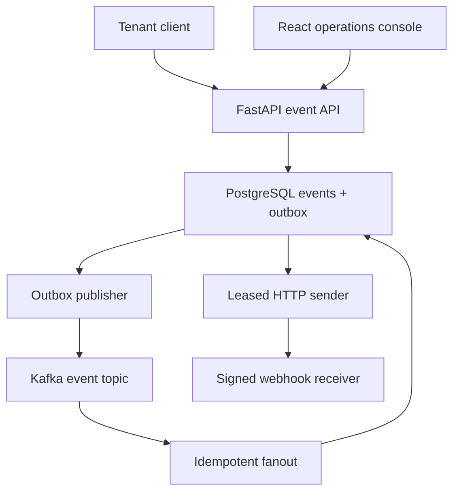

# Relay Foundry

**Durable, multi-tenant webhook delivery with Kafka, PostgreSQL, FastAPI, and a React/TypeScript operations console.**

An event API accepts a tenant's event once, records it with a transactional outbox, publishes it to Kafka, fans it out to tenant endpoints, and delivers signed HTTP requests with leases, retries, attempt history, and manual replay. It complements [Ledger Bridge](https://github.com/Karthikvk1899/ledger-bridge) (reconciliation), [Quota Forge](https://github.com/Karthikvk1899/quota-forge) (admission control), and [Saga Harbor](https://github.com/Karthikvk1899/saga-harbor) (saga coordination).



## Quick start

Requires Docker Compose. Commands run from the repository root. These defaults are **development only**, bind the API and console to loopback, and start a local test receiver.

```bash
printf 'API_KEY=%s\n' "$(openssl rand -hex 32)" > .env
docker compose up -d --build
docker compose --profile test up -d receiver
ADMIN_KEY=$(cut -d= -f2 .env)
TENANT_KEY=$(curl -fsS http://localhost:8080/admin/tenants -H "Authorization: Bearer $ADMIN_KEY" -H 'Content-Type: application/json' -d '{"id":"demo"}' | python3 -c 'import json,sys; print(json.load(sys.stdin)["api_key"])')
curl -fsS http://localhost:8080/v1/endpoints -H "Authorization: Bearer $TENANT_KEY" -H 'Content-Type: application/json' -d '{"url":"http://receiver:8090/hook"}'
curl -fsS http://localhost:8080/v1/events -H "Authorization: Bearer $TENANT_KEY" -H 'Idempotency-Key: order-1001' -H 'Content-Type: application/json' -d '{"type":"order.created","data":{"order_id":"1001"}}'
curl -fsS http://localhost:8080/v1/deliveries -H "Authorization: Bearer $TENANT_KEY"
```

Open [localhost:3000](http://localhost:3000) and paste `TENANT_KEY` into the console to inspect deliveries and attempt history. Save the endpoint signing secret from its one-time response. Delivery is asynchronous: refresh after a few seconds. Run the end-to-end assertions with `docker compose --profile test run --rm integration`. Stop with `docker compose --profile test down -v` (**deletes local data**).

## Design decisions

| Boundary | Guarantee | Important limitation |
| --- | --- | --- |
| API → PostgreSQL | Event and outbox row commit atomically; repeated key and body return the same ID | 202 is acceptance, not delivery |
| PostgreSQL → Kafka | Broker acknowledgment precedes marking an outbox row published | Duplicate Kafka records are possible after a crash |
| Kafka → deliveries | Unique `(event, endpoint)` rows; offsets committed after DB transaction | Routing uses endpoints at consumption time |
| Deliveries → HTTP | Due-row leases, fencing, HMAC, bounded retry, per-attempt record | At-least-once; receiver must deduplicate |

Tenant credentials are isolated at query boundaries; bootstrap administration is separate. The UI keeps the tenant token in memory. HTTPS and public DNS validation apply by default; Compose permits private HTTP targets solely for its local receiver. See [security](SECURITY.md) and [operations](docs/OPERATIONS.md) for SSRF, replay, failure, and deployment considerations.

## Verification

`python -m pip install -e '.[test]' && pytest -q && ruff check relay tests` runs unit tests. `cd ui && npm ci && npm audit --audit-level=high && npm run build` validates the console. GitHub Actions runs those gates plus Docker Compose integration against real PostgreSQL, Kafka, sender, and receiver. The integration verifies acceptance, idempotency, Kafka fanout, HMAC signature, retry, and tenant API. **CI success does not establish production readiness or capacity.** No throughput or AWS claim is made.

MIT licensed. Issues and focused pull requests are welcome; see [security reporting](SECURITY.md) for private vulnerability reports.
